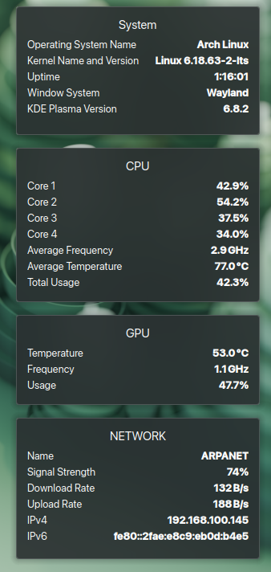
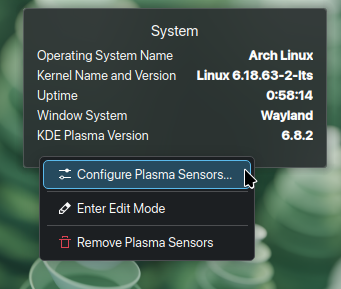
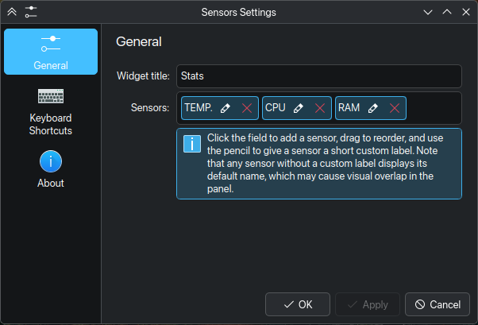

# plasma-sensors
This pure QML front end lets you choose your stats, customize their order and names, and view their live values either in a panel or as a floating element on your desktop. Sensor data is retrieved using [libksysguard](https://github.com/kde/libksysguard), KDE's own sensor infrastructure. The plasmoid has been developed and tested on GNU/Linux, and also tested on FreeBSD.

## Panel


## Desktop


## Installation
 
```bash
git clone https://github.com/ivnqc/plasma-sensors.git
cd plasma-sensors/package
kpackagetool6 -t Plasma/Applet -i .
```
 
Then add **Plasma Sensors** to a panel or the desktop via **Add or Manage Widgets…**. If nothing seems to happen, you may need to restart the KDE Plasma desktop shell:
 
```bash
systemctl --user restart plasma-plasmashell.service
```

## Usage

Right-click the widget and select **Configure Plasma Sensors...**:



Customize your widget:



## Contributing
 
Issues and pull requests are more than welcome.
 
